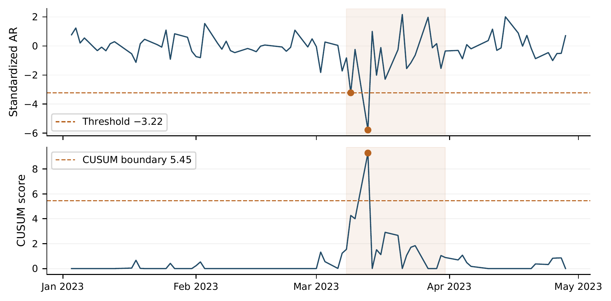
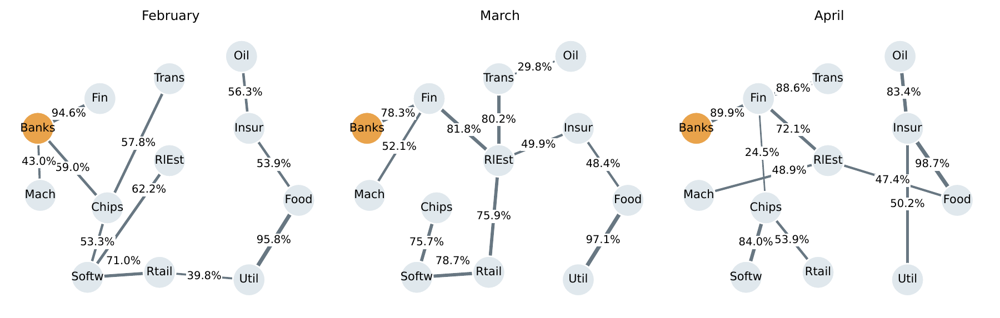

# US banking stress in March 2023

**Abnormal returns, statistical detection and industry networks**  
Alessandro Capoccia

How unusual were banking-sector returns relative to their prior relationship with the market? When would simple statistical rules identify negative deviations, and how did cross-industry relationships change during the episode?

This Python project studies those questions using daily US industry returns. It combines a market benchmark estimated on 2022 data, simulation comparisons of two detection rules, and minimum spanning trees for February–April 2023. The analysis is a retrospective case study; it does not establish crisis prediction or causal contagion.

**[Read the report](reports/banking_stress_2023_report.pdf)** · **[Open the notebook](analysis_reviewed.ipynb)** · **[Data and provenance](data/README.md)**

## Main findings

- The daily threshold rule signals on **9 and 13 March 2023**; the negative CUSUM signals on **13 March**. The 9 March observation only narrowly crosses the threshold. Each signal requires the completed daily return.
- Banking cumulative abnormal return is **−12.545 percentage points over 8–31 March**, relative to its frozen 2022 market relationship. This is a sum of arithmetic abnormal returns, not compounded investment performance.
- In the controlled experiments, CUSUM is more responsive to sustained negative mean shifts; the threshold rule has a higher same-day hit rate for isolated negative shocks. Both also respond to higher volatility.
- A roughly 5% Gaussian probability of at least one alarm over 81 days does **not** carry over to the heavier-tail and empirical-residual baselines.
- March's selected industry tree has a lower total correlation distance, while banking's degree falls from three to one. Banking's mean raw correlation rises, but the March peak disappears after adjustment using fixed 2022 market exposures.



*The shaded region marks 8–31 March. The CUSUM curve shows scores before an alarm resets the state.*

## Approach

### 1. Estimate a historical market benchmark

Fit banking excess returns to market excess returns using the 251 trading observations in 2022:

$$r_{B,t}-r_{f,t}=\alpha+\beta(r_{M,t}-r_{f,t})+\varepsilon_t.$$

Freeze the coefficients and residual scale, then compute standardized abnormal returns for the 81 trading observations from January through April 2023. Estimated banking beta is 0.938687; the 2022 residual standard deviation is 0.850488 percentage points per day.

### 2. Compare detection rules through simulation

The final daily threshold is **−3.22** standard deviations. The lower-sided CUSUM uses **k = 0.5** and **h = 5.45**, resetting after an alarm. Both are calibrated to approximately the same probability of any alarm over an 81-observation Gaussian horizon.

| Baseline over 81 observations | Threshold: any alarm | CUSUM: any alarm |
|---|---:|---:|
| Independent standard normal | 5.077% | 5.086% |
| Independent standardized Student t, 5 degrees of freedom | 29.51% | 9.15% |
| 2022 residual bootstrap, block length 1 | 47.24% | 7.00% |
| 2022 residual bootstrap, block length 5 | 41.86% | 24.68% |

The normal calibration uses 100,000 replicates; the alternative baselines use 10,000 each. Separate experiments use 1,000 paths per setting to compare persistent mean shifts, isolated shocks and volatility increases. Detection probabilities and delays use different evaluation windows where appropriate; the report defines each metric and provides the full grids.

### 3. Construct and assess industry networks

For 12 selected industries, convert monthly Pearson correlations to distances:

$$d_{ij}=\sqrt{2(1-\rho_{ij})}.$$

A custom **Kruskal algorithm with Union-Find**, path compression and union by component size constructs each MST. SciPy provides an independent implementation check. Resampling whole daily rows 1,000 times per month measures edge-selection sensitivity. Separate 2022 market models for every industry provide the benchmark-adjusted correlation comparison.

| Month | Trading days | MST total distance | Banks degree | Banks mean raw correlation | Banks mean adjusted correlation |
|---|---:|---:|---:|---:|---:|
| February | 19 | 7.698 | 3 | 0.547 | 0.026 |
| March | 23 | 6.159 | 1 | 0.676 | 0.052 |
| April | 19 | 7.721 | 1 | 0.522 | 0.081 |

Means exclude banking's self-correlation and equally weight the other 11 industries. Small adjusted averages conceal positive and negative pairwise relationships. These networks use full calendar months; the March network window differs from the 8–31 March abnormal-performance window.



*Node positions are fixed for comparison. Drawn lengths have no economic meaning, and line crossings are not nodes. Edge percentages describe selection frequencies conditional on the observed monthly samples.*

## Run the analysis

The numerical analysis was verified with **Python 3.12.14**, NumPy 2.3.5, pandas 2.2.3, Matplotlib 3.10.8 and SciPy 1.17.0. The author also confirmed a successful local VS Code notebook run under Python 3.14.4. The pinned numerical requirements reproduce the review's package versions; they are not a complete platform-specific environment lock.

From the repository root, create an environment with Python 3.12:

```bash
python3.12 -m venv .venv
source .venv/bin/activate
python -m pip install -r requirements-notebook.txt
```

On Windows, use `py -3.12 -m venv .venv`, followed by `.venv\Scripts\Activate.ps1` in PowerShell.

1. Place the two source CSVs in `data/raw`, using the filenames documented in [data/README.md](data/README.md).
2. Check whether they match the analysed vintage:

   ```bash
   python scripts/check_data.py
   ```

3. Open `analysis_reviewed.ipynb` in VS Code and select the `.venv` Python environment as the kernel, or launch JupyterLab from this directory:

   ```bash
   python -m jupyterlab
   ```

4. Restart the kernel and run all cells in order. Run from the project root so the relative data paths resolve.

A later data vintage can run but may produce different estimates. The data checker reports that difference; it does not alter or download files. If you already have a working environment, you can retain it and compare its versions with the requirements.

The notebook retains exploratory examples and learning notes. Earlier illustrative detector settings differ from the final configuration above. The report and final historical calculations use the frozen settings consistently. Network plotting uses Matplotlib; NetworkX is not required.

## Repository contents

| Path | Purpose |
|---|---|
| `analysis_reviewed.ipynb` | Main analysis notebook, with selected saved outputs |
| `reports/banking_stress_2023_report.pdf` | Complete research report |
| `reports/latex/` | Editable report source and figure PDFs; compile `main.tex` with XeLaTeX |
| `assets/` | Figures displayed in this README |
| `data/README.md` | Sources, filenames, sample windows and exact CSV fingerprints |
| `scripts/check_data.py` | Standard-library check for missing or revised source files |
| `requirements.txt` | Pinned numerical dependencies from the review environment |
| `requirements-notebook.txt` | Numerical requirements plus JupyterLab and a Python kernel |
| `.gitignore` | Excludes local environments, raw data and transient files |

## Interpretation and limitations

Monthly networks contain only 19–23 observations. An unstable month may mix different conditions, and ordinary row bootstrap does not preserve serial ordering or resolve nonstationarity. Edge frequency is not the probability of a true economic connection. High Banks–Fin frequency also does not establish that banking's degree is stable.

The one-factor benchmark uses a single estimation year. Fixed 2022 exposures need not remove the market component prevailing in 2023; omitted factors and changing exposures can remain in adjusted returns. The August 2026 source vintage makes this a retrospective analysis rather than an archived real-time test.

The work does not include formal tests of between-month network changes, causal transmission, matched-length network comparisons or uncertainty from estimating benchmark parameters. The 5% Gaussian calibration is not a generic significance level for the historical signals.

## Data and references

- [Kenneth French: 49 Industry Portfolios](https://mba.tuck.dartmouth.edu/pages/faculty/ken.french/Data_Library/det_49_ind_port.html), daily value-weighted returns.
- [Kenneth French: Fama/French Factors](https://mba.tuck.dartmouth.edu/pages/faculty/ken.french/Data_Library/f-f_factors.html), daily market excess return and risk-free return.
- Historical context and methodological references appear in the report.

The market regression, detector rules, simulation procedures, Union-Find and Kruskal routines are implemented in the notebook. NumPy and pandas support numerical work and data handling; Matplotlib produces the figures; SciPy checks the tree results.
